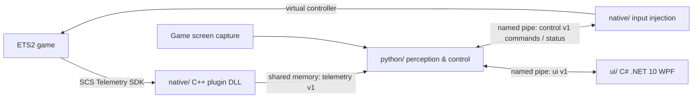

# Architecture

Status: draft v0.1 — defines module boundaries and the IPC contract before implementation.

## Overview

## Modules
| Module | Language | Responsibilities | Must not |
|---|---|---|---|
| `native/plugin` | C++ | Load as SCS SDK plugin, publish telemetry to shared memory | Contain driving logic |
| `native/input` | C++ | Apply steering/throttle/brake commands via virtual controller and return applied-state packets | Decide commands |
| `python/` | Python 3 | Perception, planning, control loop, safety limits | Touch game memory directly |
| `ui/` | C# .NET 10 WPF | Settings, status, start/stop, logs | Run the control loop |
| `shared/` | Spec | Versioned IPC schemas | — |

## IPC Contract
| Channel | Transport | Direction | Notes |
|---|---|---|---|
| [telemetry v1](../shared/ipc/telemetry.v1.md) | Shared memory | plugin → python | 4096-byte mapping, 240-byte v1.0 struct, SI units, version header, sequence counter |
| [control v1](../shared/ipc/control.v1.md) | Named pipe | python → input commands; input → python status | Overlapped I/O; 64-byte command and 64-byte status packets; steering [-1,1], throttle [0,1], brake [0,1] |
| [ui v1](../shared/ipc/ui.v1.md) | Named pipe | python ↔ ui | JSON status with state_revision, config, commands; [JSON Schema](../shared/ipc/ui.v1.schema.json) |

The [shared contract overview](../shared/README.md) defines versioning and common units. Channel specifications define field layout, update behavior, and safety rules.

## Safety
- Driver override always wins; any manual input disengages autopilot.
- Control commands are rate- and range-limited in Python and again in `native/input`.
- `native/input` independently enforces the command timeout, manual-override latch, and speed-dependent steering amplitude limit.

## Cross-cutting
- Platform: Windows 10/11 x64 only.
- i18n: English default; all user-facing strings in resource files.
- CI: GitHub Actions `windows-latest`.
- Whether `native/input` is a separate process or hosted in another native process is [Need decision: ADR pending]; the IPC and peer-identity contract applies to either arrangement.

<!-- Edited by: Anthropic-Claude_Code -->
<!-- Edited by: OpenAI-Codex_Responsible: Source_Code -->
